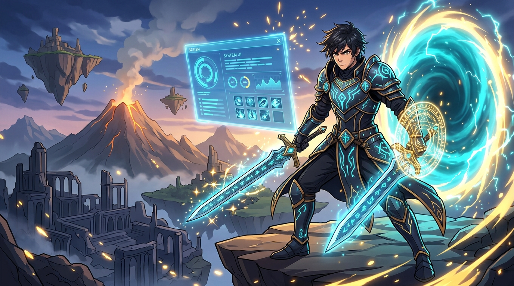
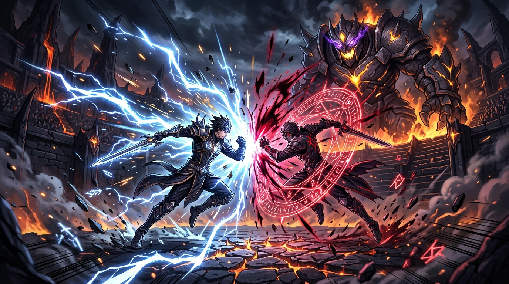

# ميدان الأبطال — قارة إيثيريا (Maydan Al-Abtal)



> لعبة أكشن وقتال ثلاثية الأبعاد (3D Action RPG) وعالم مفتوح بواجهة **«النظام» (Manhwa System UI)**، تعمل مباشرة في المتصفح بمحرك رسوميات ثنائي (**WebGL 1/2** + **Canvas2D** خفيف) مع دعم اللعب الفردي، الغارات، الزعماء السريين، التنافس المصنّف، والغرف الجماعية المباشرة عبر **Node.js**.

---

## أبرز المميزات والتقنيات

### 1. محرك رسوميات ثنائي مستقل عن الجودة (`Render Engine Switcher`)
- **اكتشاف تلقائي للجهاز (`auto`)**: يفحص قدرات المتصفح وبطاقة الرسوميات (`WebGL 2` ثم `WebGL 1`) ويميز بين البطاقات الحقيقية ومسرّعات البرمجيات (`SwiftShader / llvmpipe`) لاختيار المحرك الأسرع بسلاسة.
- **تبديل يدوي مستقل**: يمكنك اختيار **WebGL 1/2** أو **المحرك الخفيف (Canvas2D)** في أي وقت من الشاشة الرئيسية أو داخل المعركة، مع انتقال فوري وتبديل احتياطي آمن تلقائياً إذا فقد المتصفح سياق WebGL.
- **6 مستويات جودة حتى «الجودة المستحيلة» (`impossible`)**:
  - `اقتصادي` · `متوازن` · `عالي` · `فائق` · `أسطوري` · **`مستحيل` (الجودة المستحيلة)**.
  - في مستوى **«الجودة المستحيلة»** على WebGL تحصل على طابع واقعي ناعم (*Stylized Realism* مستوحى من ألعاب الأكشن الكلاسيكية النابضة بالحياة مثل *GTA Vice*): خامات إجرائية ناعمة، إضاءة ثلاثية متوازنة (`Key + Hemisphere + Rim + IBL`)، ظلال ناعمة متتبعة للاعب (`PCFSoftShadowMap`)، معالجة ما بعد الرندر (`Bloom + Vignette + FXAA`) على البطاقات الفعلية، وتبديل تلقائي للإضاءة والضباب حسب الساحة والإقليم.

---

### 2. حرية الحركة والقتال الديناميكي


- **قفز حر وتحكم جوي (`Free Jump & Air Control`)**: اضغط `Space` للقفز في أي لحظة مع زمن تعويض الحافة (`Coyote Time`)، وتخزين ضغطة القفز، وتوجيه هوائي سلس، وتأثير هبوط وغبار عند اللمس.
- **الاندفاع السلس والميلان (`Momentum & Turn Banking`)**: تسارع وتباطؤ طبيعي، وميلان جسم المقاتل أثناء الانعطاف السريع والركض داخل الساحات والعالم المفتوح.
- **سلسلة المراوغة والضربة القاضية (`Dodge-Chain Roll-Strike`)**: عند الهجوم مباشرة بعد المراوغة (`Shift` / زر المراوغة) ينفّذ البطل ضربة اندفاعية دائرية بضرر إضافي (`+15%`) وفرصة ضربة حاسمة أعلى (`+12%`).
- **كاميرا حرة 360° بمحورين (`Yaw + Pitch + Zoom`)**: اسحب بإصبعك أو بالفأرة لتدوير الكاميرا أفقياً ورأسياً بحرية مع تقريب وإبعاد سلس عبر عجلة الفأرة across **6 زوايا كاميرا** (الشخص الثالث، خلف الكتف، إيزومتري 3D، جانبي قتالي، علوي تكتيكي، سينمائي حر).

---

### 3. واجهة قابلة للتخصيص بالكامل (`HUD & Control Customizer`)
- **وضع السينما / الهدوء (`Zen Mode` — مفتاح `H`)**: يخفي كل عناصر الواجهة فوراً بنقرة واحدة مع زر استعادة صغير شفاف للاستمتاع بالمشهد الكامل.
- **نافذة تخصيص شاملة (4 أقسام)**:
  1. **المحرك والجودة**: عرض نوع بطاقة الرسوميات المكتشفة وتبديل المحرك والجودة لحظياً.
  2. **واجهة القتال (`HUD`)**: شريط تمرير لحجم الواجهة (`75% – 125%`) وشفافيتها، مع مفاتيح تشغيل/إيقاف مستقلة للرادار، صندوق المهمة، شريط الإقليم، عداد الأداء (`FPS`)، تلميحات الأزرار، أرقام الضرر العائمة، وشريط الزعيم.
  3. **أزرار الحاسوب**: إعادة تعيين أي زر حركة أو قتال أو مهارة أو جرعة بالنقر المباشر مع حل التعارضات تلقائياً.
  4. **تخطيط الهاتف**: 3 قوالب لمسية جاهزة (`قياسي متوازن` · `مضغوط` · `موزّع واسع`) مع تحكم بالحجم وموضع عصا التحكم وأزرار القتال على محوري `X/Y` ودعم الوضع الأفقي التلقائي.

---

## عوالم اللعب والمحتوى

| المسار / النظام | الوصف والتفاصيل |
| :--- | :--- |
| **قارة إيثيريا المفتوحة** | عالم مفتوح بقطر **14,000 متر** يعمل ببث المقاطع الحي (`100×`)، ويضم **9 أقاليم** مختلفة المناخ والضباب والإضاءة، مع **9 أحجار انتقال سريع (`M`)**. |
| **الزعماء السريون ومناطق الأحداث** | معارك حراس قُدامى مخفيين في أرجاء القارة ومناطق تحدٍ موقوتة بمكافآت نادرة من الذهب والخبرة والجواهر. |
| **الساحات الست الكبرى** | *قلعة السبج، فوهة الصهارة، قمة الجليد، كثبان شمس الحجر، الحرم السماوي، كولوسيوم الهاوية* — كل ساحة بإضاءة مخصصة ومنصات مرتفعة (`+12% ضرر`) ومحاريب دعم. |
| **الشخصيات المسالمة والعقود** | 5 شخصيات غير لاعبة في القرى الآمنة لجمع الأعشاب والمعادن والبلورات، مقايضتها بأوسمة النقابة، وإنجاز العقود. |
| **الأفتار والمهارات والدمج** | 8 سمات مقاتل مع مخطط راداري حي، **12 سلاحاً** قابلاً للترقية، عتاد 3 خانات، شبكة قدرات، ونظام دمج مهارات (`Fusion Skills`). |
| **التحديات اليومية والإنجازات** | تحديات متجددة وإنجازات تفتح ألقاباً حصرية للشخصية، مع حفظ تلقائي فوري في المتصفح (`localStorage`). |

---

## لوحة التحكم الافتراضية

### الحاسوب (قابلة لإعادة التعيين بالكامل من نافذة التخصيص)

| الإجراء | الزر الافتراضي | ملاحظات |
| :--- | :---: | :--- |
| التحرك (أمام / خلف / يسار / يمين) | `W` `S` `A` `D` | حركة ناعمة مرتبطة باتجاه الكاميرا |
| **القفز الحر** | `Space` | يدعم التحكم الجوي وقفزة الحافة |
| الهجوم السريع / الهجوم الثقيل | `J` أو النقر / `K` | الهجوم بعد المراوغة يفجّر **ضربة الاندفاع** |
| المراوغة / الصد والدرع | `Shift` / `L` | سلسلة مراوغة متصلة للهجوم الخاطف |
| المهارات القتالية (1–4) | `Q` `R` `Z` `X` | مع قدرات دمج خاصة عند التفعيل |
| الركض السريع / التفاعل / الخريطة | `C` / `G` / `M` | فتح الصناديق، التحدث مع NPC، الانتقال السريع |
| تغيير زاوية الكاميرا / إخفاء الواجهة | `V` / `H` | + سحب الفأرة للتدوير 360° والعجلة للتقريب |
| الجرعات (صحة / طاقة / غضب) | `1` `2` `3` | استخدام سريع أثناء القتال |

### الهاتف والوضع الأفقي
- **عصا تحكم لمسية 360°** بجانب أزرار **قفز، مراوغة، صد، هجوم، ضربة ثقيلة، ومهارات 1–4**.
- **سحب الشاشة** لتدوير الكاميرا أفقياً ورأسياً بحرية (مع حساب التدوير الأفقي للشاشة تلقائياً).
- خيار **«تفعيل الوضع الأفقي»** مع قابلية ضبط القالب والحجم والإزاحة من **«تخصيص التحكم والواجهة»**.

---

## التشغيل على حاسوبك عبر Node.js

### المتطلبات
- **Node.js** الإصدار `18.18.0` أو أحدث (يُفضّل `Node.js 20` أو `22 LTS`).
- **npm** (يُثبّت تلقائياً مع Node.js).

### 1. التشغيل السريع بنقرة واحدة
- **Windows**: انقر مرتين على ملف `run-local.bat` (يتحقق من Node.js، يثبت الحزم عند الحاجة، ويشغّل اللعبة تلقائياً).
- **Linux / macOS**:
  ```bash
  bash run-local.sh
  ```

### 2. التشغيل اليدوي عبر الطرفية (`Terminal / CMD`)
1. تثبيت المكتبات (للمرة الأولى فقط):
   ```bash
   npm install
   ```
2. تشغيل بيئة التطوير (الخادم الكامل + WebSocket للغرف الجماعية والدردشة):
   ```bash
   npm run dev
   ```
3. أو بناء نسخة الإنتاج وتشغيلها مباشرة عبر Node.js:
   ```bash
   npm run start:prod
   ```

بعد التشغيل افتح المتصفح على العنوان:
```text
http://localhost:3000
```

### إعداد المنفذ الاختياري (`.env`)
يمكنك نسخ `.env.example` إلى `.env` وتعديل المنفذ إذا كان `3000` قيد الاستخدام:
```env
PORT=3000
```

---

## أوامر البناء والفحص البرمجي

| الأمر | الوظيفة |
| :--- | :--- |
| `npm run typecheck` | التحقق من سلامة الأنواع عبر `tsc --noEmit` |
| `npm run lint` | فحص الأخطاء الساكنة والأنواع في المشروع |
| `npm run build` | بناء الحزمة النهائية للإنتاج في مجلد `dist/` |
| `npm run start` | تشغيل الخادم عبر `node server.ts` |
